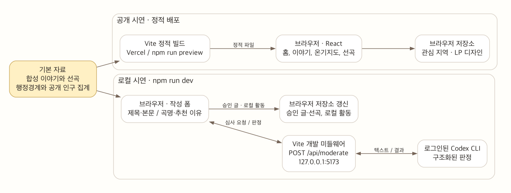

# 따공 · 우리 동네의 작은 친절

대가 없이 오간 작은 친절을 동네 이야기로 남기고, 온기지도에서 다시 찾아 읽는 웹앱입니다.

**Codex Community Hackathon – Seoul 출품작** · 2026년 11월 27일 · **제작 시간 2시간 30분**(14:00–16:30 KST). 행사에서 만든 프로토타입을 바탕으로 소스와 제작 과정을 교육·학습용으로 공개합니다. [행사 안내](https://luma.com/p8l79x8m) · [해커톤 공개 시연](https://daily-warming.vercel.app/)

## 따공을 만든 이유

노래를 들으며 따뜻한 이야기를 접한 날, 마음이 편안해지고 사람들에게 정이 갔습니다. 같은 동네에서도 누군가 우산을 기울여 주거나 무거운 짐을 들어 주는데, 그런 일은 감사 인사 한마디와 함께 지나갈 때가 많습니다. 일상의 친절을 기록해 두고, 자기 동네에서도 그런 일이 있었음을 발견할 곳을 만들고 싶었습니다.

따공의 예시 이야기에서 지우는 비 오는 날 정류장까지 우산을 함께 쓴 일을 남깁니다. 예시 댓글에서 소담은 “저도 비 오는 날 우산을 조금 기울여 볼게요.”라고 적습니다. 한 사람이 남긴 고마움이 읽는 이웃에게 오늘 해 볼 작은 일을 떠올리게 하는 것이 따공이 기대하는 변화입니다.

## 무엇을 만들었나요

| 화면 | 해 볼 일 |
| --- | --- |
| 홈과 지역별 소식 | 최신·인기 이야기 카드를 열고, 홈을 아래로 스크롤해 16개 광역 행정구역의 예시 이야기 94편을 찾아봅니다. |
| 온기지도 | 같은 지역의 최근 7일 이야기 집계를 인구 10만 명당으로 환산한 값을 개나리색 농도로 봅니다. 로컬 시연에서는 승인된 이야기 한 편이 지역에 1P를 더합니다. |
| 프로필·알림·대화 | 이야기 제목과 배지 달성 조건, 예시 응원과 대화를 읽습니다. 로컬 시연에서 좋아요와 대화 답장도 체험할 수 있습니다. |
| 노래 추천 | 선곡 이유를 읽고 LP 색과 라벨을 꾸밉니다. 곡은 공식 영상 링크에서 들을 수 있습니다. |

첫 파일럿에서는 지역 이야기를 처음 읽은 사람 중 다음 날부터 7일 안에 같은 지역 글을 다시 읽은 비율을 보려고 합니다. 이후에는 어떤 글이 기억에 남았는지, 그 글을 읽고 직접 해 본 일이 있는지 물어볼 계획입니다.

## 아키텍처

<picture>
  <source media="(prefers-color-scheme: dark)" srcset="docs/diagrams/architecture-dark.png">
  
</picture>

React와 TypeScript로 UI를 만들고 Vite로 빌드합니다. 해커톤 공개 시연은 Vercel의 정적 빌드이며, 예시 콘텐츠를 로그인 없이 읽을 수 있습니다. 관심 지역과 LP 디자인은 현재 브라우저에 저장됩니다. 글쓰기와 심사는 로컬 개발 모드에서 체험합니다. [아키텍처 상세](docs/architecture.md)

## 빠른 시작

Node.js 22.18 이상과 npm이 필요합니다. 아래 명령으로 패키지를 설치한 뒤 합성 이야기와 지도부터 둘러봅니다.

```bash
git clone https://github.com/Ryu-Jemu/ttagong-codex-hacathon.git
cd ttagong-codex-hacathon
npm ci
npm run build
npm run preview
```

브라우저에서 `http://127.0.0.1:4173`을 엽니다. 빌드와 기본 시연은 API 키나 Codex 로그인 없이 실행됩니다.

게시 심사는 별도로 체험할 수 있습니다. Codex CLI에서 로그인 상태를 확인하고 `npm run dev`로 시작한 뒤 `http://127.0.0.1:5173`에서 **글쓰기 → 게시 심사 요청**을 누릅니다. 심사를 요청하면 제목과 본문이 로그인된 Codex CLI로 전달되므로 합성 문장으로 시도해 주세요. [로컬 심사 흐름](docs/architecture.md) · [문제 해결](docs/troubleshooting.md)

## 해커톤에서 작업한 방식

Codex 세션 8개가 기획 검토, 반론 검증, 모바일 UX, 지도·데이터, 문서, 시연, 통합, 독립 감사를 맡았습니다. Git 작업 사본을 나누고 공유 메시지에 요청·수신·완료를 기록했습니다. 같은 문서의 동시 쓰기를 잠금으로 막고, 새 검토 요청과 주기 확인으로 대기 중인 세션을 다시 불렀습니다. 통합본은 iPhone 시뮬레이터 Safari와 공개 Vercel 주소에서 비교했습니다. [역할 분담과 검증 기록](docs/development.md) · [발표 대본](docs/pitch.md)

| 위치 | 내용 |
| --- | --- |
| `src/ui/` | 화면, 접근성, 탐색 |
| `src/core/` | 합성 예시, 게시 심사 계약, 브라우저 상태 |
| `src/regions/` | 지역 경계와 포인트 집계 |
| `dev/moderate.ts` | 로컬 Codex CLI 연결 |
| `scripts/` | 지도 입력 확인과 아키텍처 그림 생성 |

```bash
npm test
npm run build
python3 scripts/krmap-tiles.py --check
```

## 라이선스와 출처

자체 코드와 문서는 MIT 라이선스입니다. 지도 경계와 Pretendard는 각각의 라이선스를 따릅니다. 이야기와 대화는 합성 예시이며, 지도는 출처를 표시한 공개 행정경계와 시도 단위 인구 집계를 사용합니다. 행사명과 제품명은 제작 환경과 출처를 설명하기 위해 표기했습니다. [MIT 라이선스](LICENSE) · [자료 이용 범위](NOTICE.md) · [기여자](AUTHORS.md) · [기여하기](CONTRIBUTING.md)
