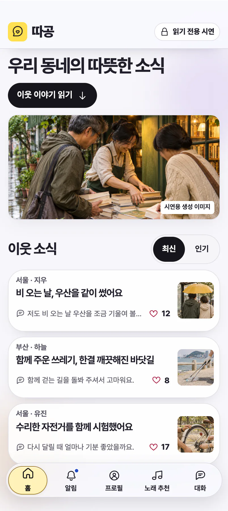
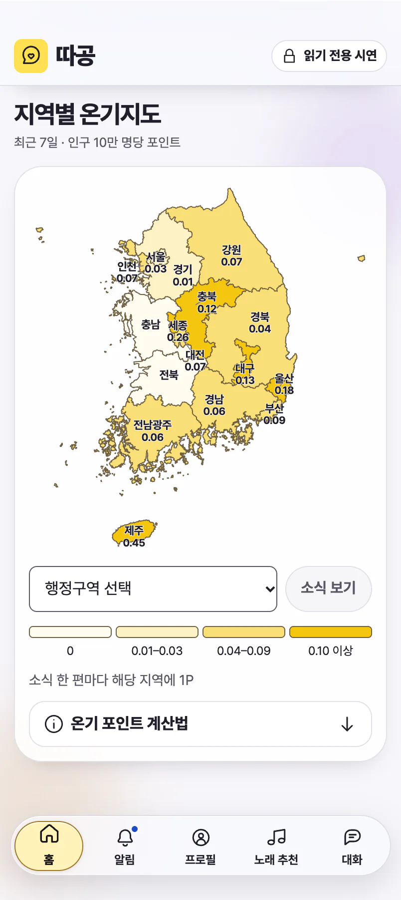
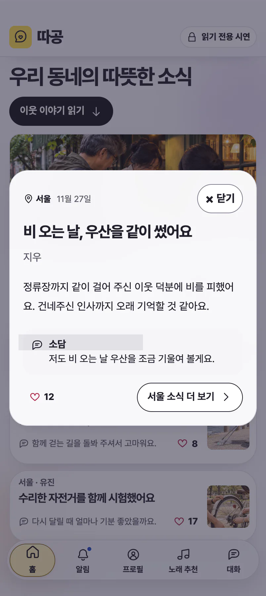
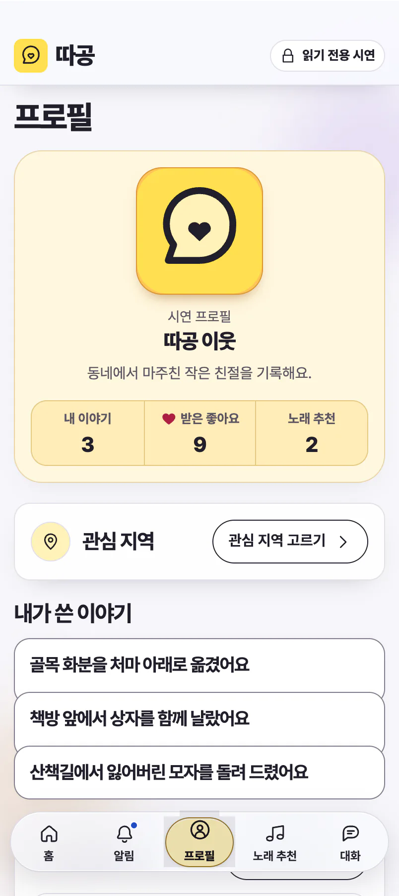
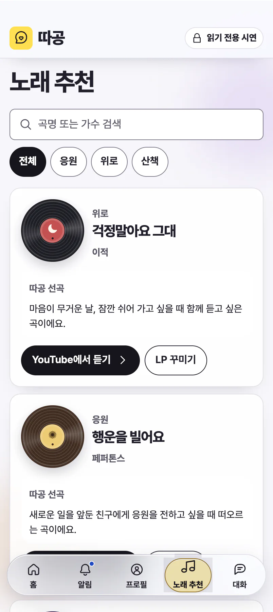
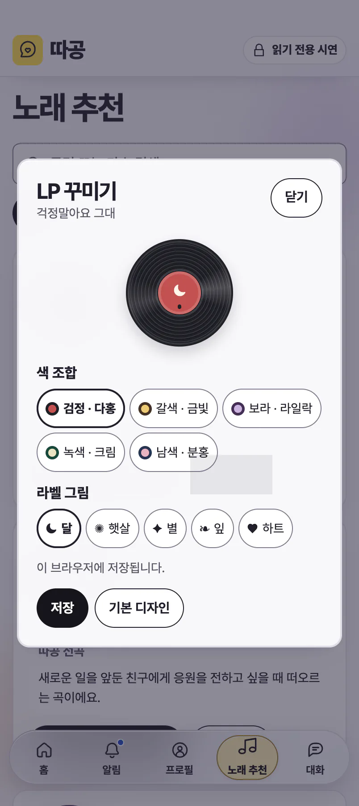

<div align="center">
  
  <h1>따공</h1>
  <p><strong>어제 읽은 친절을 오늘 우리 동네에 한 번 더.</strong></p>
  <p>대가 없이 오간 작은 친절을 이야기로 남기고, 온기지도에서 우리 동네 소식을 다시 찾아 읽는 웹앱입니다.</p>
  <p><a href="https://daily-warming.vercel.app/">해커톤 시연 보기</a> · <a href="#화면-둘러보기">화면 둘러보기</a> · <a href="#빠른-시작">빠른 시작</a></p>
</div>

**Codex Community Hackathon – Seoul 출품작** · 2026년 11월 27일 · **제작 시간 2시간 30분**(14:00–16:30 KST). [행사 안내](https://luma.com/p8l79x8m) · [1분 발표 대본](docs/pitch.md)

## 우산을 조금 기울여 준 사람

노래를 들으며 따뜻한 이야기를 접한 날, 마음이 편안해지고 사람들에게 정이 갔습니다. 우리 동네에서도 누군가는 우산을 기울여 주거나 무거운 짐을 함께 들어 줍니다. 그런 일은 감사 인사 한마디와 함께 지나가기 쉽습니다. 마음이 지치는 날에도, 같은 골목에서 오간 친절을 다시 찾아 읽을 곳을 만들고 싶었습니다.

따공의 예시 이야기에서 지우는 비 오는 날 이웃과 정류장까지 우산을 함께 쓴 일을 남깁니다. 예시 댓글에서 소담은 “저도 비 오는 날 우산을 조금 기울여 볼게요.”라고 적습니다. 한 사람이 고마웠던 일을 남겨 두면, 다른 이웃은 내일 해 볼 작은 친절을 발견할 수 있습니다.

> 혼자 뿌듯함을 느끼지 말고 나누세요~

## 화면 둘러보기

1. **홈에서 우산 이야기 열기.** 최신·인기 소식에서 본문과 예시 응원 댓글을 읽습니다.
2. **지도에서 우리 동네 찾기.** 홈에서 아래로 스크롤해 16개 광역 지역의 예시 94편을 둘러보고, 다시 읽고 싶은 곳을 관심 지역으로 저장합니다.
3. **오늘 들을 노래 고르기.** 선곡의 이유를 읽고 곡별 LP 색과 라벨을 꾸며 봅니다. 곡은 공식 영상 링크에서 들을 수 있습니다.

| 오늘의 이웃 소식 | 행정구역 온기지도 |
| :---: | :---: |
| <a href="docs/screenshots/home.webp"></a> | <a href="docs/screenshots/warmth-map.webp"></a> |
| **우산 이야기** | **내 프로필과 기록** |
| <a href="docs/screenshots/story.webp"></a> | <a href="docs/screenshots/profile.webp"></a> |
| **이웃의 선곡** | **LP 꾸미기** |
| <a href="docs/screenshots/music.webp"></a> | <a href="docs/screenshots/vinyl-editor.webp"></a> |

*이 저장소의 공개판을 모바일 화면 크기로 실행해 촬영했습니다. 이미지를 누르면 크게 볼 수 있습니다.*

온기지도는 최근 7일의 지역 이야기 포인트를 주민등록 인구 10만 명당으로 환산해 보여 줍니다. 첫 파일럿에서는 첫 열람 다음 날부터 7일 안에 같은 지역의 글을 다시 읽은 비율과, 글을 읽은 뒤 실제로 해 본 작은 친절이 있었는지를 확인하려고 합니다.

## 어떻게 만들었나요

Codex 세션 8개가 기획 검토, 구현, 문서, 시연과 독립 감사를 나눠 진행했습니다. Git 작업 사본을 분리하고 공유 메시지에 요청과 처리 상태를 남겼습니다. 통합본은 iPhone 시뮬레이터 Safari와 공개 Vercel 주소에서 비교했습니다. [역할 분담과 작업 기록](docs/development.md) · [문제 해결과 수정 커밋](docs/troubleshooting.md)

<picture>
  <source media="(prefers-color-scheme: dark)" srcset="docs/diagrams/architecture-dark.png">
  
</picture>

React와 TypeScript로 화면을 만들고 Vite로 빌드합니다. **공개 시연**에서는 예시 이야기·알림·대화를 읽고 관심 지역과 LP 디자인을 브라우저에 저장합니다. **로컬 시연**에서는 게시 심사와 좋아요, 예시 대화 답장을 체험합니다. 승인된 이야기 한 편은 해당 지역에 1P를 더합니다. [아키텍처 상세](docs/architecture.md)

## 빠른 시작

Node.js 22.18 이상과 npm이 필요합니다. 아래 명령을 실행한 뒤 브라우저에서 `http://127.0.0.1:4173`을 엽니다. 기본 탐색은 API 키 없이 시작할 수 있습니다.

```bash
git clone https://github.com/Ryu-Jemu/ttagong-codex-hacathon.git
cd ttagong-codex-hacathon
npm ci
npm run build
npm run preview
```

<details>
<summary>로컬 게시 심사와 소스 검증</summary>

Codex CLI를 설치하고 로그인 상태를 확인한 뒤 개발 서버를 시작합니다. `http://127.0.0.1:5173`의 **글쓰기 → 게시 심사 요청**에서 합성 문장을 사용해 보세요. 심사 요청 시 제목과 본문이 로그인된 Codex CLI로 전달됩니다.

```bash
codex login status
npm run dev
```

```bash
npm test
npm run build
python3 scripts/krmap-tiles.py --check
```

| 경로 | 역할 |
| --- | --- |
| `src/ui/` | 화면과 탐색 |
| `src/core/` | 합성 예시, 게시 심사 계약, 브라우저 상태 |
| `src/regions/` | 지역 경계와 포인트 계산 |
| `dev/moderate.ts` | 로컬 Codex CLI 연결 |

</details>

## 라이선스와 출처

자체 코드와 문서는 MIT 라이선스를 따릅니다. 이야기와 대화는 합성 예시입니다. 지도 경계와 Pretendard의 사용 조건과 출처는 NOTICE에 기록했습니다. [MIT 라이선스](LICENSE) · [자료 출처](NOTICE.md) · [기여자](AUTHORS.md) · [기여하기](CONTRIBUTING.md)
