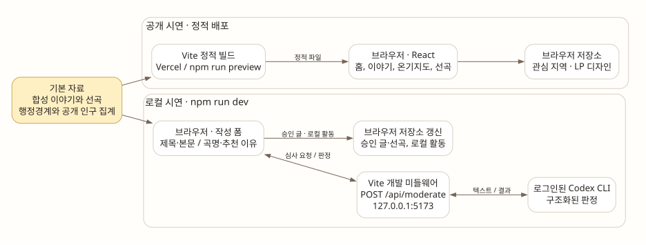

# 따공 아키텍처

따공은 React와 TypeScript로 만든 웹 앱입니다. 공개 시연은 Vite가 만든 정적 파일로 실행됩니다. 게시 심사를 체험하려면 개발 서버를 로컬에서 실행하고 Codex CLI에 로그인합니다.



## 실행 환경

| 구분 | 정적 미리보기와 Vercel | 로컬 개발 시연 |
| --- | --- | --- |
| 실행 | `npm run build`로 만든 `dist/`를 Vite 미리보기나 Vercel에서 제공 | `npm run dev`로 Vite 개발 서버 시작 |
| 콘텐츠 | 번들에 포함된 예시 글, 추천곡, 알림, 대화 읽기 | 예시 콘텐츠와 현재 브라우저에서 남긴 시연 활동 |
| 작성과 반응 | 읽기 전용 | 게시 심사 요청, 좋아요, 예시 대화 답장 |
| 브라우저 설정 | 관심 지역과 곡별 LP 디자인 저장 | 관심 지역과 곡별 LP 디자인 저장 |

정적 빌드를 로컬에서 확인합니다. 미리보기의 기본 주소는 `http://127.0.0.1:4173`입니다.

```bash
npm ci
npm run build && npm run preview
```

게시 심사까지 확인할 때는 Codex CLI를 설치합니다. 로그인 상태가 아니라면 `codex login`으로 로그인한 뒤 개발 서버를 시작합니다. 기본 주소는 `http://127.0.0.1:5173`입니다.

```bash
codex login status
npm run dev
```

### 로컬 게시 심사

1. 브라우저에서 소식의 제목과 본문이나 곡명·가수와 추천 이유를 입력합니다. 같은 주소의 Vite 개발 서버로 `POST /api/moderate`를 보냅니다.
2. 개발 서버의 미들웨어가 루프백 접속과 `Origin`, 입력 형식을 검사합니다. 유효한 요청은 임시 작업 폴더에서 `codex exec`로 전달합니다. CLI는 이 컴퓨터에 로그인한 계정을 사용하며, 제목과 입력 본문을 심사에 전달합니다.
3. 미들웨어가 결과 JSON을 검증해 브라우저에 반환합니다. 승인된 소식이나 추천만 이 브라우저의 시연 데이터에 추가합니다. 차단, 보류, 심사 장애 때는 입력을 남겨 수정하거나 다시 요청할 수 있습니다.

개발 전용 미들웨어가 붙는 조건은 [Vite 설정](../vite.config.ts)에서 확인할 수 있습니다. [심사 처리](../dev/moderate.ts), [결과 검증](../src/core/moderation.ts), [시연 상태 저장](../src/core/demo.ts)으로 로컬 흐름이 이어집니다.

## 지역 온기지도

- 한국 시간으로 오늘을 포함한 최근 7일에 올라온 이야기만 집계합니다. 게시 시각이 잘못됐거나 현재보다 나중인 글은 제외하고, 같은 지역 안에서 이야기 ID별로 한 번씩 셉니다.
- 이야기 한 편은 해당 지역에 1P를 더합니다. **인구 10만 명당 온기**는 `지역 포인트 × 100,000 ÷ 해당 지역의 주민등록 인구`입니다. 인구가 없거나 유효하지 않으면 환산값을 표시하지 않습니다.
- 지도 숫자와 색상 구간은 환산값을 소수 둘째 자리까지 반올림한 결과를 사용합니다. 범례는 0, 0.01~0.03, 0.04~0.09, 0.10 이상입니다. 지역 소식 화면에서는 원래 포인트와 인구 보정 포인트를 함께 확인할 수 있습니다.
- 홈에서 지도에 가까워지면 행정경계 모듈을 불러옵니다. 지도를 불러오지 못했을 때는 **지역별 소식 보기**로 전국 소식과 지역 선택에 접근할 수 있습니다.

계산은 [지역 인구와 집계 코드](../src/regions/index.ts), 지도 표시와 입력은 [행정경계 컴포넌트](../src/ui/BoundaryMap.tsx)에서 확인할 수 있습니다. 타일 원본에서 추출한 축약명과 순서는 목록에 쓰이고, 지도 화면에는 실제 경계 SVG가 표시됩니다. [데이터·에셋 출처](../NOTICE.md)

## 화면과 데이터

| 역할 | 코드 |
| --- | --- |
| 홈, 지역 선택, 다섯 탭과 화면 전환 | [App.tsx](../src/ui/App.tsx) |
| 예시 콘텐츠와 지역별 추가 이야기 | [fixtures.ts](../src/core/fixtures.ts), [regional-fixtures.ts](../src/core/regional-fixtures.ts) |
| 배지 달성 조건과 알림 생성 | [badges.ts](../src/core/badges.ts), [demo.ts](../src/core/demo.ts) |
| 추천곡과 LP 디자인 | [Music.tsx](../src/ui/Music.tsx), [RecordArtwork.tsx](../src/ui/RecordArtwork.tsx) |

실행하거나 화면에서 확인할 때 문제가 생기면 [문제 해결](troubleshooting.md)을 참고하세요.

## 그림 재생성

Graphviz와 한글을 지원하는 글꼴을 설치하고 `sh scripts/render-architecture.sh`로 라이트·다크 SVG와 PNG를 만듭니다. 원하는 경우 `TTAGONG_DIAGRAM_FONT`에 사용할 로컬 글꼴 이름을 지정합니다. [그림 원본](diagrams/architecture.dot) · [렌더 스크립트](../scripts/render-architecture.sh)
